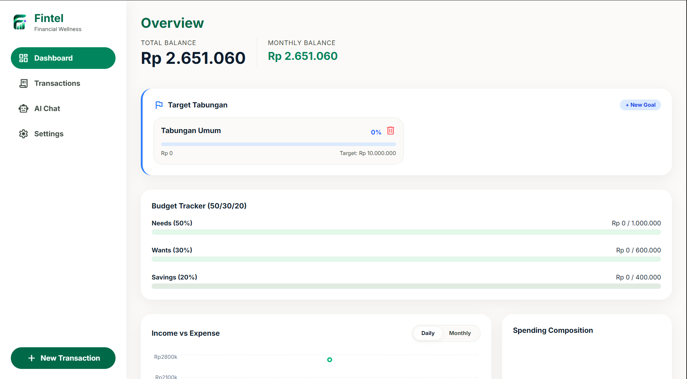

# Fintel
Aplikasi manajemen keuangan personal offline dengan AI lokal untuk membantu mahasiswa mengelola uang pakai rumus 50/30/20.

 

## Apa itu Fintel?
Fintel hadir untuk menyelesaikan masalah mahasiswa dan anak muda yang sering kebingungan mengatur jatah uang bulanan. 
Daripada pusing mencatat angka secara kaku, Fintel membantu Anda dengan sistem pencatatan semudah *chatting* (menggunakan asisten AI lokal yang paham bahasa sehari-hari), lalu otomatis merapikan pengeluaran Anda menggunakan standar metrik keuangan 50/30/20.

Kelebihan utamanya: **privasi mutlak**. Semua kecerdasan buatan dan *database* berjalan 100% *offline* di komputer Anda sendiri. Tidak ada satu pun riwayat transaksi atau saldo Anda yang dikirimkan ke server internet.

## Fitur Utama
- **Pencatatan Cerdas:** Input transaksi secara manual atau cukup ketik di chat AI (contoh: *"Habis makan soto 15rb"*).
- **Auto-Kalkulasi 50/30/20:** Uang Anda otomatis dipilah ke dalam *bucket* Kebutuhan (50%), Keinginan (30%), dan Tabungan (20%).
- **Visualisasi Finansial:** Grafik riwayat pemasukan-pengeluaran dan komposisi gaya hidup bulanan.
- **Linked Per-Goal Savings:** Buat target tabungan spesifik dan pantau *progress bar*-nya terisi secara dinamis.
- **Saran Fintel:** Dapatkan rekomendasi dan teguran finansial personal dari asisten AI yang disesuaikan dengan kondisi dompet Anda bulan ini.
- **100% Offline & Aman:** Menggunakan *database* lokal dengan fitur *auto-backup* 7 hari.

## Screenshot

## Tech Stack
- **Frontend:** React + TypeScript + Tailwind CSS v4 + Recharts
- **Backend/Desktop:** Tauri v2 (Rust)
- **Database:** SQLite (Bundled, Local)
- **AI Engine:** Ollama (Local LLM, recommended model: llama3.2:3b)

## Cara Menjalankan

### Prasyarat
1. **Node.js** (v18+) dan **npm**
2. **Rust** dan ekosistem *build tools* C++ untuk Windows (Visual Studio Build Tools)
3. **Ollama** (Terinstal dan berjalan di sistem Anda). Pastikan Anda sudah mengunduh model dengan menjalankan perintah ollama run llama3.2:3b di terminal.

### Mode Development
`ash
# 1. Install dependencies NPM
npm install

# 2. Jalankan Fintel di mode development
npm run tauri dev
`

### Build Installer (Production)
`ash
# Kompilasi aplikasi menjadi installer .msi / .exe untuk Windows
npm run tauri build
`
Installer akan digenerate dan dapat ditemukan di direktori src-tauri/target/release/bundle/msi/.

## Status Project
Fintel saat ini berada pada tahap **MVP (Minimum Viable Product)**. 
Seluruh fitur inti pencatatan, kalkulasi *budget*, dan *chat* AI lokal telah berfungsi penuh. Fokus ke depan adalah pada penyempurnaan akurasi *parsing* asisten AI dan penambahan kustomisasi rumus rasio *budget* (bagi yang tidak ingin memakai baku 50/30/20).

## Lisensi & Kredit
**Pengembang:** Marzhendo Galang S.
