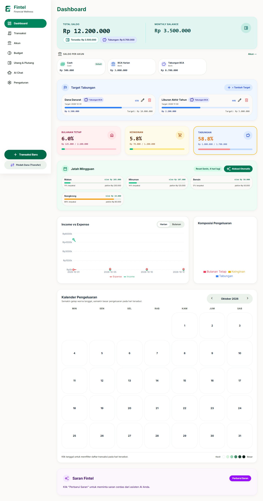
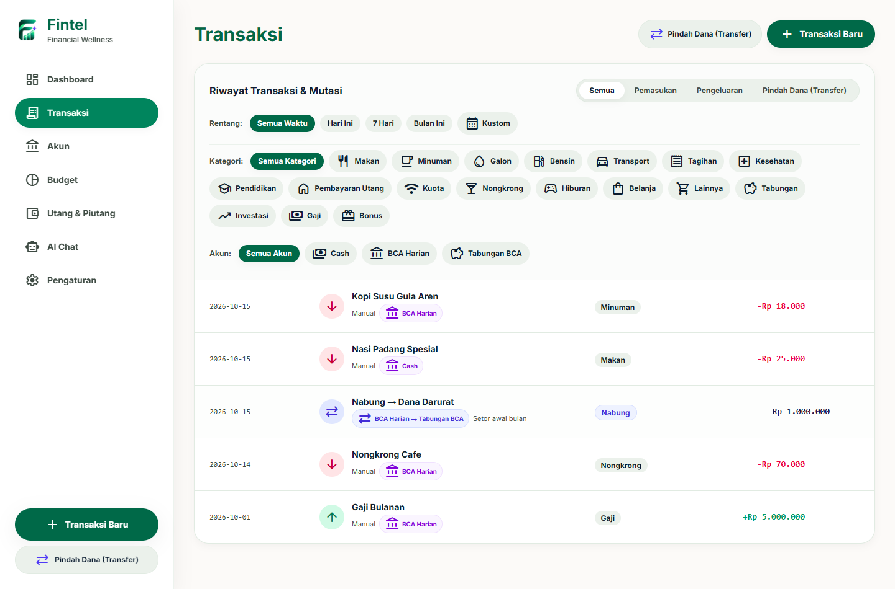
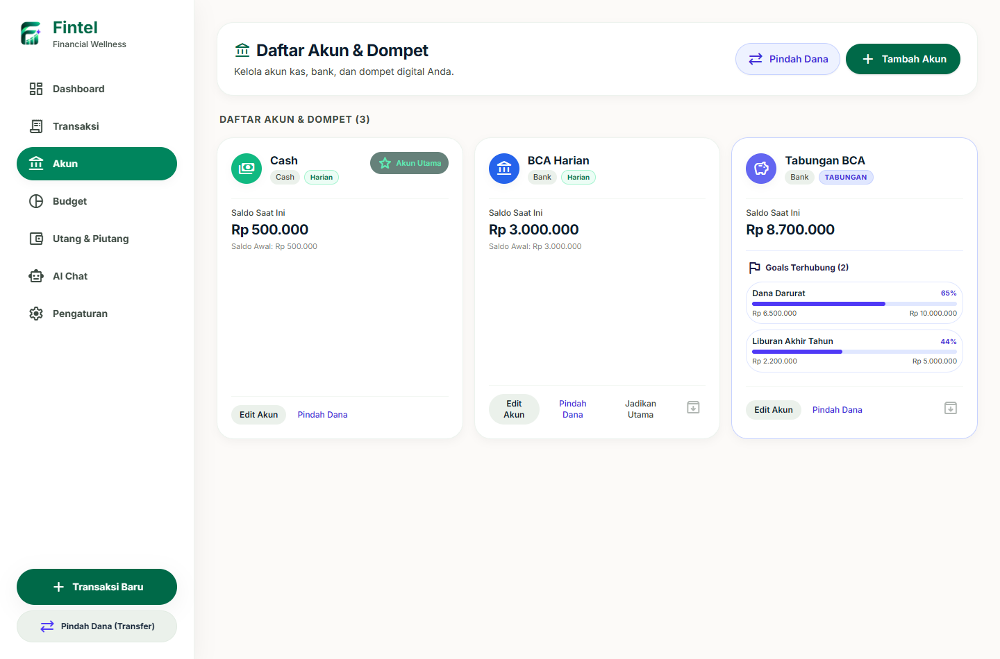
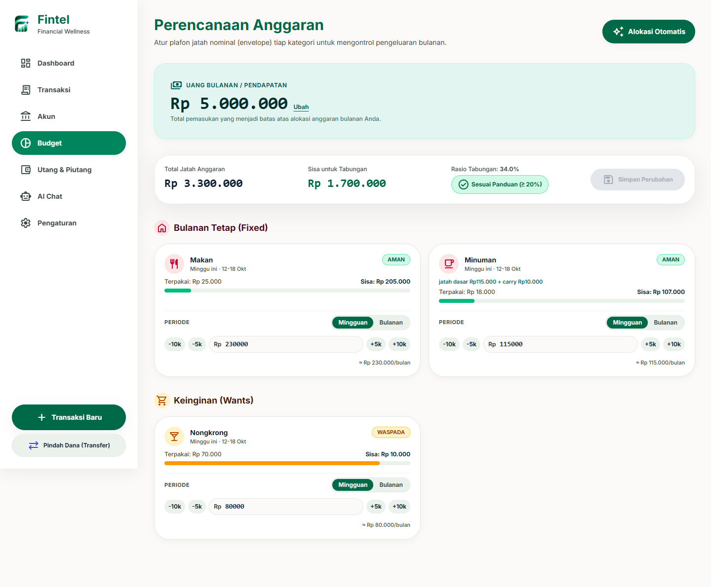
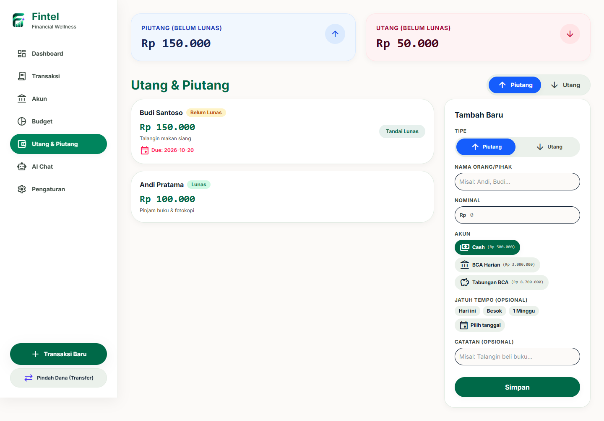
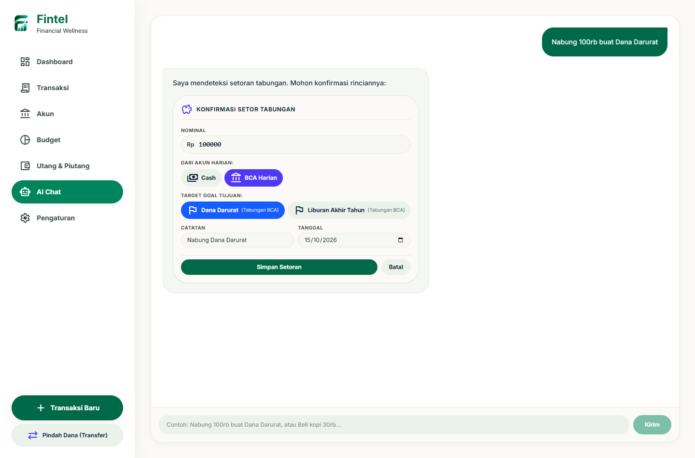
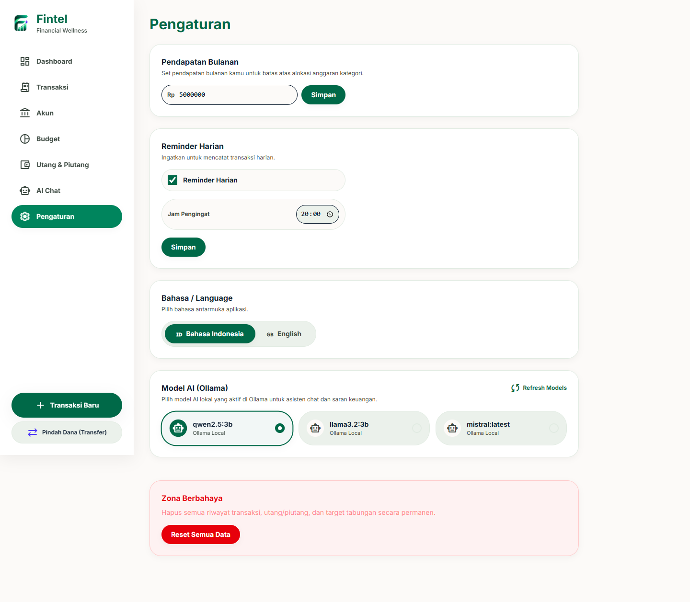

# Fintel — Financial Wellness

<p align="center">
  
</p>

<p align="center">
  <strong>Aplikasi Manajemen Keuangan Personal Offline-First dengan AI Lokal & Envelope Budgeting</strong>
</p>

<p align="center">
  
  
  
  
  
  
  
</p>

---

## 💡 Apa itu Fintel?

**Fintel** adalah aplikasi manajemen finansial personal modern yang dirancang khusus untuk membantu mahasiswa, *freelancer*, dan profesional muda menguasai arus kas mereka tanpa ribet dan tanpa rasa cemas (*financial wellness*).

Berbeda dari aplikasi keuangan konvensional yang kaku dan menyimpan data Anda di server pihak ketiga, Fintel mengutamakan **Privasi 100% Mutlak (*Offline-First*)**. Semua kalkulasi finansial, basis data SQLite, hingga kecerdasan buatan (*Local LLM*) berjalan langsung di komputer Anda tanpa memerlukan koneksi internet ataupun mengirim data Anda ke server luar.

---

## ✨ Fitur Unggulan

### 🏦 1. Multi-Akun & Pemisahan Dana Nyata (Harian vs Tabungan)
- **Kategori Akun Lengkap:** Kelola berbagai rekening dan dompet seperti *Cash*, Bank (BCA, Mandiri, BRI, BNI, dll.), dan E-Wallet (GoPay, OVO, DANA, ShopeePay).
- **Pemisahan Akun Harian vs Tabungan:** Akun bertipe Tabungan dipisahkan secara tegas dari dana operasional harian.
- **Transparan & Akurat:** Kartu saldo utama menampilkan rincian **Tersedia (Akun Harian)** dan **Tabungan (Akun Tabungan)** sehingga Anda tidak akan keliru membelanjakan uang tabungan.
- **Pindah Dana (Transfer):** Pindahkan dana antar akun harian, atau lakukan setoran/penarikan tabungan yang langsung memperbarui saldo dan progres target goal.

### ✉️ 2. Perencanaan Anggaran Amplop (*Envelope Budgeting*)
- **Fleksibilitas Periode:** Atur plafon anggaran per kategori dalam siklus **Mingguan** atau **Bulanan**.
- **Carry-Over Otomatis:** Kategori mingguan memiliki fitur akumulasi sisa jatah (*carry-over*) yang otomatis bergulir setiap hari Senin dengan perhitungan *anchor date* yang aman.
- **Alokasi Otomatis (Pure Rust Engine):** Fitur pembagian persentase cerdas berbasis integer basis point (BP) dengan penguncian target tabungan minimal 20% sesuai panduan finansial sehat.
- **Indikator Visual & Plafon:** Status warna intuitif: Aman (<80%), Waspada (80-100%), dan Over (>100%).

### 🎯 3. Target Tabungan Terintegrasi (*Linked Saving Goals*)
- **Terkoneksi ke Akun Tabungan:** Setiap target goal (misal: *Dana Darurat*, *Liburan*, *Beli Gadget*) terhubung langsung ke satu Akun Tabungan.
- **Progres Dinamis:** Progres nominal dihitung secara riil dari akumulasi transfer setoran (*deposit*) dan penarikan (*withdrawal*).
- **Shortcut Tabungan:** Catat setoran tabungan langsung dari modal transaksi melalui alur cepat `Dari Harian ➔ Kartu Goal ➔ Nominal ➔ Simpan`.

### 🤝 4. Pencatat Utang & Piutang (*Debts & Receivables*)
- **Pelacakan Mudah:** Catat pinjaman uang yang Anda berikan (*Piutang*) atau terima (*Utang*) beserta pihak terkait dan tanggal jatuh tempo.
- **Notifikasi Jatuh Tempo:** Pengingat otomatis di Windows saat tanggal jatuh tempo utang/piutang tiba.
- **Pelunasan 1-Klik:** Tandai lunas dengan satu klik yang secara otomatis mencatat mutasi kas ke akun pilihan Anda.

### 🤖 5. Asisten AI Lokal & Saran Fintel (Ollama)
- **Natural Language Logging:** Cukup ketik transaksi sehari-hari seperti *"Habis beli nasi padang 25rb pakai Cash"* atau *"Nabung 100rb buat Dana Darurat"*. AI akan mengekstrak nominal, tipe, kategori, akun, dan target goal tujuan.
- **Kartu Konfirmasi Interaktif:** Konfirmasi transaksi dan setoran tabungan menggunakan chip/kartu yang ramah dan aman dari salah input.
- **Saran Fintel:** Dapatkan ringkasan kondisi kesehatan dompet dan rekomendasi belanja cerdas berdasarkan analisis data bulan berjalan.
- **Bebas Langganan:** Bekerja dengan model LLM open-source lokal via Ollama (Qwen 2.5, Llama 3.2, Mistral).

### 📅 6. Kalender Pengeluaran & Analitik Visual
- **Heatmap Pengeluaran:** Kalender harian interaktif dengan gradasi warna sesuai besar nominal belanja harian. Klik tanggal untuk langsung memfilter transaksi hari tersebut.
- **Grafik Interaktif:** Pantau tren arus kas (*Cash Flow*) harian/bulanan dan diagram donat komposisi pengeluaran (*Bulanan Tetap, Keinginan, Tabungan*).

### 🎨 7. Desain Soft & Friendly
- Antarmuka modern bernuansa pastel yang menenangkan mata.
- **Bebas Dropdown Kaku:** Seluruh pemilihan opsi menggunakan *chips*, kartu, dan segmented buttons interaktif tanpa elemen `<select>`.
- **Dukungan Multi-Bahasa:** Tersedia dalam Bahasa Indonesia (ID) dan English (EN).
- **Material Symbols Rounded:** Ikon rapi dan proporsional tanpa masalah *overflow* pada badge.

---

## 📸 Tangkapan Layar Halaman Aplikasi

### 1. Dashboard
Ringkasan finansial menyeluruh: Saldo Utama (Tersedia & Tabungan), Saldo per Akun, Target Tabungan, Realisasi Anggaran 3 Pos, Jatah Mingguan, Grafik Arus Kas, Heatmap Kalender, dan Saran Cerdas Fintel.



---

### 2. Riwayat Transaksi & Mutasi
Filter fleksibel berdasarkan tipe (Semua, Pemasukan, Pengeluaran, Pindah Dana), rentang tanggal cepat, kategori, dan akun. Menampilkan mutasi pemindahan dana secara netral dan elegan.



---

### 3. Kelola Akun & Dompet
Manajemen seluruh akun kas, rekening bank, e-wallet, dan rekening tabungan. Dilengkapi status akun utama, rincian saldo, dan target goal yang tersambung pada akun Tabungan.



---

### 4. Perencanaan Anggaran (*Envelope Budget*)
Pengaturan jatah nominal mingguan dan bulanan per kategori, kalkulasi setara bulanan, live preview rasio tabungan, carry-over mingguan, dan dialog alokasi otomatis.



---

### 5. Utang & Piutang
Pencatatan piutang dan utang dengan tanggal jatuh tempo, ringkasan saldo belum lunas, dan tombol pelunasan instan.



---

### 6. Asisten AI Chat Lokal
Input transaksi alami dengan pemahaman konteks bahasa Indonesia & Inggris, serta deteksi pintar setoran tabungan (*deposit transfer*) dengan chip akun & goal interaktif.



---

### 7. Pengaturan
Pengaturan pendapatan bulanan, konfigurasi pengingat harian, pemilihan bahasa antarmuka, pemilihan model LLM Ollama, dan manajemen data.



---

## 🛠️ Arsitektur & Tech Stack

| Lapisan | Teknologi | Peran |
| :--- | :--- | :--- |
| **Desktop Shell** | [Tauri v2](https://v2.tauri.app/) | Runtime desktop ultra-ringan, aman, dan hemat memori |
| **Financial Engine** | [Rust](https://www.rust-lang.org/) | Kalkulasi finansial murni (deterministic, integer cents/basis points), validasi transfer, SQLite ORM, TDD |
| **Frontend Framework** | [React 19](https://react.dev/) + [TypeScript](https://www.typescriptlang.org/) | Arsitektur UI komponen modular dan type-safe |
| **Styling** | [Tailwind CSS v4](https://tailwindcss.com/) | Sistem desain kustom Soft/Friendly pastel |
| **State Management** | [Zustand](https://zustand-demo.pmnd.rs/) | State global yang reaktif dan ringan |
| **Data Visualization** | [Recharts](https://recharts.org/) | Grafik garis interaktif & diagram donat |
| **Local AI Engine** | [Ollama](https://ollama.ai/) | LLM lokal (Qwen 2.5 / Llama 3.2) untuk ekstraksi NLP & saran finansial |
| **Storage & Backup** | [Rusqlite (SQLite)](https://github.com/rusqlite/rusqlite) | Penyimpanan data lokal ACID dengan migrasi atomik & auto-backup 7 hari |

---

## 🚀 Memulai (Panduan Instalasi & Development)

### Prasyarat Sistem
1. **Node.js** (v18 atau lebih baru) & **npm**
2. **Rust & Cargo** (v1.75 atau lebih baru) serta Microsoft C++ Build Tools untuk Windows
3. **Ollama** (Opsional untuk fitur AI):
   - Unduh Ollama dari [ollama.ai](https://ollama.ai/)
   - Jalankan model yang direkomendasikan di terminal:
     ```bash
     ollama run qwen2.5:3b
     ```

### Instalasi Repository
```bash
# Clone repository
git clone https://github.com/marzhendo/fintel.git
cd fintel

# Install dependencies frontend
npm install
```

### Menjalankan dalam Mode Development
```bash
# Menjalankan aplikasi desktop Fintel (Frontend Vite + Backend Tauri Rust)
npm run tauri dev
```

### Menjalankan Pengujian (Testing)
```bash
# Menjalankan 42 unit test backend Rust (TDD Financial & Envelope Engine)
cd src-tauri
cargo test
cd ..

# Memverifikasi typecheck dan build frontend
npm run build
```

### Build Installer Production (.msi / .exe)
```bash
npm run tauri build
```
File installer siap pakai akan dihasilkan di folder:
`src-tauri/target/release/bundle/msi/` atau `src-tauri/target/release/bundle/nsis/`

---

## 🔒 Privasi & Keamanan Data
- **Tanpa Telemetri & Cloud Tracking:** Fintel tidak mengumpulkan analitik atau data penggunaan apa pun.
- **Penyimpanan Lokal:** Basis data SQLite tersimpan di direktori lokal aplikasi (`%APPDATA%\com.fintel.app\fintel.sqlite`).
- **Auto-Backup:** Salinan cadangan otomatis dibuat berkala di folder `backups/` setiap kali aplikasi mendeteksi pergantian hari.

---

## 📄 Lisensi & Kontributor
- **Pengembang:** Marzhendo Galang S.
- Dilisensikan di bawah lisensi MIT. Silakan gunakan dan kembangkan untuk tujuan pembelajaran dan manajemen finansial pribadi.
